 

## ☾ about me

- 🌙 hi, i'm **annie**, a dev who codes best after dark
- 🎧 building **[MusiKPL](https://github.com/liathy/MusiKPL)**, a cozy music player for Windows, Linux & Android, written in Rust
- 💫 it finds new music for you, makes auto mixes, hosts listening jams with friends & scrobbles to Last.fm
- 🪐 currently exploring **Angular**, **Tailwind** & **Flutter**
- ✨ fun fact: my music player knows my taste better than i do

 

## ✧ tech constellation

  

## ✧ featured project & on my headphones

  
  

## ✧ stardust stats

  
  
  

## ☄ catching contributions

  <picture>
    <source media="(prefers-color-scheme: dark)" srcset="https://raw.githubusercontent.com/liathy/liathy/output/snake-dark.svg"/>
    <source media="(prefers-color-scheme: light)" srcset="https://raw.githubusercontent.com/liathy/liathy/output/snake-light.svg"/>
    
  </picture>

 

  

✧ thanks for visiting, sweet dreams ☾ ✧

