<picture>
  <source media="(prefers-color-scheme: dark)" srcset="https://raw.githubusercontent.com/liathy/liathy/output/snake-dark.svg"/>
  <source media="(prefers-color-scheme: light)" srcset="https://raw.githubusercontent.com/liathy/liathy/output/snake-light.svg"/>
  
</picture>

  

  

